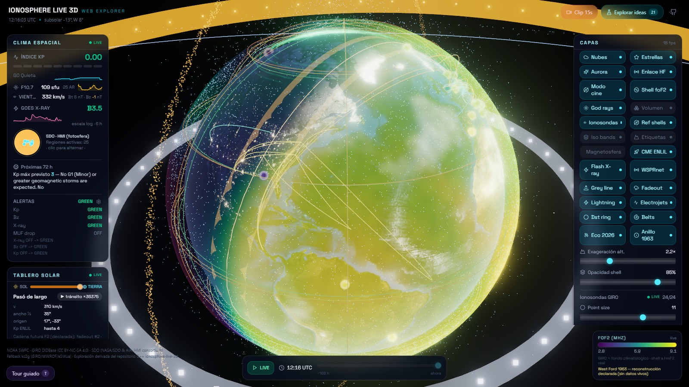
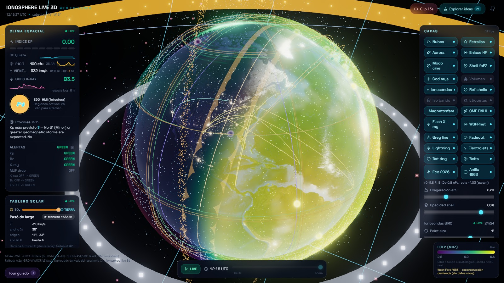
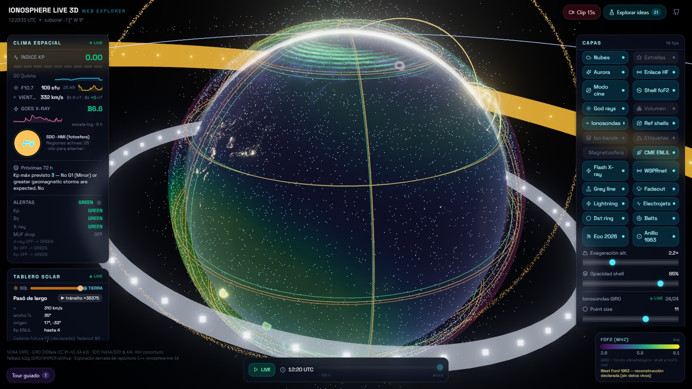
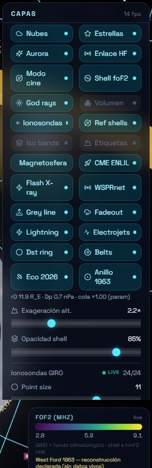

# Ionosphere Live 3D — Web

Live 3D visualization of Earth's ionosphere in the browser: an interactive
Earth model (Three.js/WebGL) with atmosphere, ionosphere, auroras,
magnetosphere, satellites and space-weather panels, powered by **real data from
public sources** (NOAA, NASA, Kyoto WDC, CelesTrak, ...).

## Companion repository

This repo is the browser half of a two-repository project:

| Repository | What it is |
|---|---|
| **`ionosphere-live-3d-web`** (this one) | Browser reference app (Next.js + Three.js). It is where a layer, a data source or a visual idea is prototyped first. |
| [`ionosphere-live-3d`](https://github.com/valledemena/ionosphere-live-3d) | Native C++17 / OpenGL 4.0 desktop app. It ports the same layers with the same defaults, the same tooltips and the same persistence rules. |

They are complementary by design, not duplicates:
**the web app explores, the desktop app re-implements natively.** Everything
that was ported (geospace overlays, magnetopause, solar-wind river, Van Allen
belts, satellites, WSPR arcs, CME front, sprites/whistlers, LASCO C2 + D-RAP,
DONKI flares, AE, RBE, Voyager and the Parker spiral) keeps its original names,
scales and declared approximations in both repos. Neither of them ever
fabricates data: when a source is down the layer draws nothing and says why.

## Screenshots

Overview (1600×900, local production build, 2026-10-26):



| Magnetosphere and solar wind | Stars disabled |
| --- | --- |
|  |  |

Layers panel, with the new `Stars` toggle and the per-layer help text:



> In the screenshot with `Stars` disabled, the dots still on the globe are ECO
> 2026 satellites, not stars.

## Data sources

All of them are public and require no API key:

- `services.swpc.noaa.gov` — NOAA SWPC: aurora (OVATION), space weather, D-RAP (validation image)
- `api.weather.gov` — NOAA/NWS: active weather alerts
- `ccmc.gsfc.nasa.gov` — NASA CCMC DONKI: CME, flare (FLR), RBE, GST
- `celestrak.org` — NORAD TLEs (active group)
- `db.satnogs.org` — SatNOGS TLEs
- `lgdc.uml.edu` — DIDBase ionosondes (foF2)
- `noaa-goes18/19.s3.amazonaws.com` — GOES GLM flashes
- `prop.kc2g.com` — KC2G ionosondes
- `sdo.gsfc.nasa.gov` — SDO solar images (HMI/AIA)
- `soho.nascom.nasa.gov` — LASCO C2 coronagraph (SOHO)
- `ssd.jpl.nasa.gov` — JPL Horizons (Voyager)
- `wdc.kugi.kyoto-u.ac.jp` — Kyoto WDC: Dst and AE
- `wsprnet.org` — WSPR spots

## Satellites and honest degradation

`/api/satellites` uses this chain, in order:

1. **CelesTrak (live)** — the full active catalogue.
2. **Local snapshot `2026-10-17`** — a frozen CelesTrak capture (15,927
   objects), always labelled `snapshot ... (no live)`.
3. **SatNOGS (live)** — live fallback, but it only carries ~1.7k objects with a
   registered transmitter.
4. **`unavailable`** — null state; data is never invented.

The snapshot is preferred over SatNOGS so the visual density of ECO 2026 is
preserved. The response includes `source`, `sourceLabel`, `attribution` and
`count`; `unavailable` is never cached.

## Stack

- **Next.js 16** (App Router, `output: standalone`) + **React 19**
- **Three.js** — WebGL scene (Earth, auroras, magnetosphere, satellites)
- **Tailwind CSS 4** + **Radix UI / shadcn** (only `toast.tsx`/`toaster.tsx`
  remain in `src/components/ui`; the rest of the shadcn scaffolding was removed
  in drop-352 because it had no consumers)
- **Zustand**, **TanStack Query/Table** and other template dependencies
  (`framer-motion`, `next-intl`, `date-fns`, `sharp`, `uuid`, `zod`,
  `react-markdown`, `@dnd-kit/*`, `@reactuses/core`) — removed in drop-351:
  none of them had active imports under `src/`
- **Vitest 5** (tests), **ESLint 9** (flat config in `eslint.config.mjs`),
  **TypeScript 5**
- Tested with **Node 24 / npm 11**

## UI and preferences

- The **LAYERS** panel gathers the scene toggles: clouds, stars, aurora, HF
  link, magnetosphere, CME, WSPR, satellites, etc. Every control has an
  explanatory `title` and `aria-label`, plus `aria-pressed`.
- **`Stars`** hides or shows the starfield without rebuilding the scene; the
  change is applied on the next frame.
- **`Cinema mode`** enables automatic camera rotation.
- **Solar-wind** particles are coloured by speed, `Bz` and density, with an
  additive halo.
- Visual settings are stored in `localStorage` under the key
  `ionosphere.scene-settings.v1` and restored on reload. They are validated and
  clamped to each control's range; an invalid value falls back to the default.
- Toggles, sliders and modes are persisted (including `cinema`,
  `replaySpeed` and `replayLoop`), but **not** the transient replay state
  (`timeMode`, `replayMinutes`, `replayPlaying`): a reload goes back to `LIVE`
  so the app never starts in a hidden historical view.
- If `localStorage` is blocked or full, the app keeps working without
  persistence.

## API routes

15 routes (`src/app/api/**/route.ts`):

- 14 data routes: `/api/ae`, `/api/aurora`, `/api/cme`, `/api/dst`, `/api/flares`,
  `/api/ionosondes`, `/api/lightning`, `/api/msis`, `/api/rbe`, `/api/satellites`,
  `/api/solar-image`, `/api/space-weather`, `/api/voyager`, `/api/wspr`
- `/api` (root): health check `{"message":"Hello, world!"}`

## Development (Windows)

The `package.json` scripts are portable (plain Node, no POSIX utilities):

```powershell
# Dev (port 3000)
npm run dev

# Build (production: next build + copy to .next/standalone)
npm run build

# Serve the standalone build (defaults PORT=3011, HOSTNAME=127.0.0.1;
# PORT/HOSTNAME from the environment take precedence)
npm run start

# Tests / lint
npm test        # vitest run; if .next exists, delete it FIRST (it can break resolution)
npm run lint    # eslint .
```

For another port/host: `$env:PORT='3025'; npm run start` (PowerShell) or
`PORT=3025 npm run start` (bash). `scripts/start.mjs` pins
`NODE_ENV=production` and the `3011`/`127.0.0.1` defaults.

The standalone server can take ~5-7 s to accept connections after printing
"Ready"; an immediate `curl` may return 000/ECONNREFUSED. Probes and CI must
retry for a few seconds before declaring failure.

## Environment and secrets

- **No API keys are needed**: every source is public.
- `.env` is not versioned (`.gitignore` covers `.env` and `.env.*`) and no
  `.env` files are required: the app only reads `NODE_ENV`; at runtime the
  standalone server takes `PORT`/`HOSTNAME` from the environment only (it does
  not load `.env`).

## Assets (textures)

| File | Dimensions | Quality | Use |
| --- | --- | --- | --- |
| `public/textures/earth-day.jpg` | 5400×2700 | q88 | day texture |
| `public/textures/earth-night-hires.jpg` | 8192×4096 | q86, progressive 4:4:4 | high-resolution night side |
| `public/textures/earth-night.jpg` | 2048×1024 | q84 | fallback for modest GPUs |

The loader only uses the hires texture when
`renderer.capabilities.maxTextureSize >= 8192` (constant
`NIGHT_HIRES_MIN_MAX_TEXTURE` in `IonosphereScene.tsx`); otherwise it loads the
fallback.

## Project gates

| Gate | Command | Local status (2026-10-26, on drop-356) |
| --- | --- | --- |
| ESLint | `npm run lint` | 0 errors, 0 warnings |
| TypeScript | `npx tsc --noEmit` | 0 |
| Tests | `npm test` | 461/461 (48 files) |
| Build | `npm run build` | 0 |
| npm audit | `npm audit --omit=dev` | 1 critical pending (Next 16.3.8) |

Note: the gates delete `.next` before `npm test`; the `test` script does not.
The `npm audit` vulnerability comes from the Next version pinned in
`package.json` and was not touched by this UI/documentation change.

## Development flow (drops)

- Implementation by agents (MIMO/BEAM) → review verdict (GLM) → applied to the
  canonical repo by MUSE → smoke test.
- **Only MUSE** commits/tags/pushes. Force-push is forbidden.

## License

GPL-3.0 — see [LICENSE](LICENSE).
